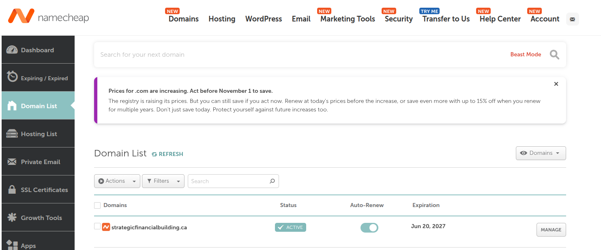
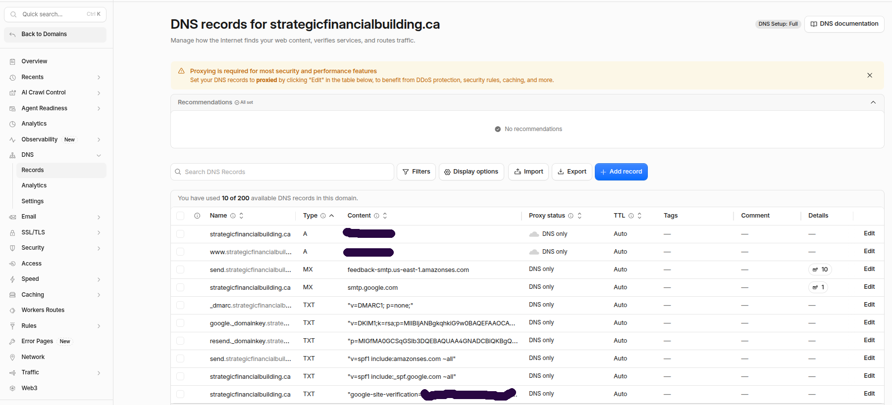
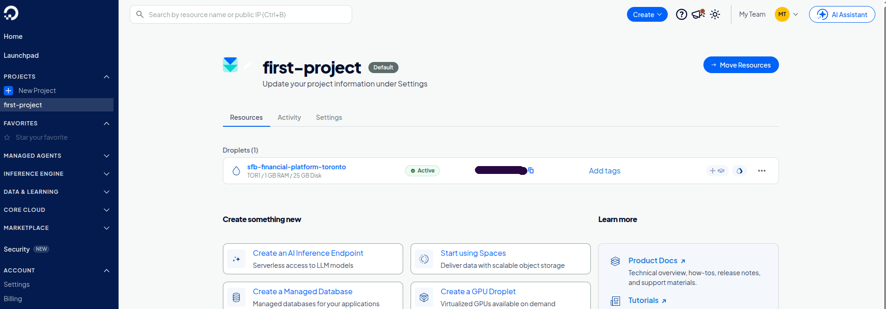
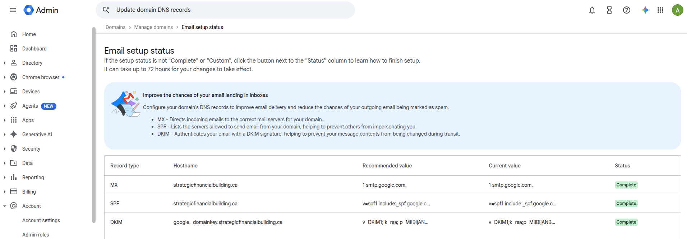
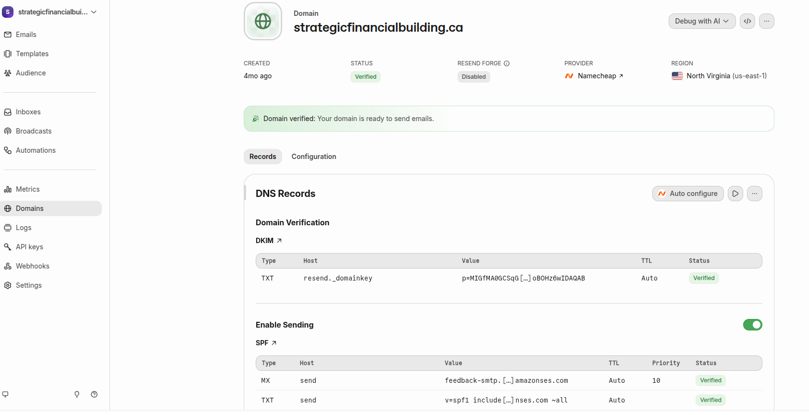
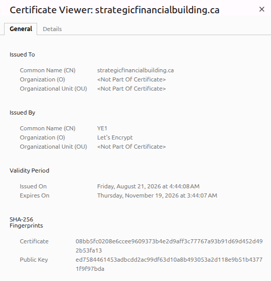

# SFBwise: Engineering Showcase

**A production web platform I designed, built, secured, tested, and deployed end to end as a solo engineer.**

Live: https://www.strategicfinancialbuilding.ca
Author: Azeez Adebayo Adeniyi, B.Sc. Computing Science (University of Alberta, 2026), PhD Computational Chemistry

> **About this repository.** This is a technical portfolio of how SFBwise is engineered. It documents architecture, security decisions, deployment, and testing. It intentionally excludes production source, credentials, admin surfaces, and business terms.

---

## At a glance

| | |
|---|---|
| **Type** | Full stack web application, in production |
| **Frontend** | Single page app in vanilla JavaScript, HTML5, CSS3 (no framework), Chart.js, jsPDF, Web Speech API |
| **Backend** | Node.js, Express, SQLite (WAL), JWT auth, Resend email API |
| **Infrastructure** | VPS, Nginx reverse proxy, PM2, TLS, own domain with Cloudflare DNS, Google Workspace mail, Resend transactional email |
| **Testing** | Playwright end to end suites, independent recomputation of numeric results |
| **Scale of the client code** | About forty interactive calculators across fifteen tool areas, two country modes |
| **Ownership** | Design, implementation, security review, testing, deployment, and operations |

---

## 1. Architecture

```
                         Browser (visitor)
        +------------------------------------------------+
        |  Single page app: HTML, CSS, vanilla JavaScript |
        |  All calculations run here                      |
        |  Charts: Chart.js    PDF export: jsPDF          |
        |  Read aloud: Web Speech API                     |
        +----------------------+-------------------------+
                               |  contact form fields and
                               |  anonymous visit pings only
                               v
        +------------------------------------------------+
        |  Nginx (TLS termination, reverse proxy)         |
        +----------------------+-------------------------+
                               v
        +------------------------------------------------+
        |  Node.js + Express (managed by PM2)             |
        |  helmet, CORS allowlist, rate limiting,         |
        |  JWT in httpOnly cookie, output escaping        |
        +--------+-----------------------+----------------+
                 |                       |
                 v                       v
        +----------------+     +---------------------------+
        | SQLite (WAL)   |     | Resend email API          |
        | prepared       |     | branded alerts from a     |
        | statements     |     | verified company domain   |
        +----------------+     +---------------------------+
```

### Key decision: compute on the client, keep the server blind

All calculator inputs are processed in the browser. The server never receives them, and the PDF report is generated in the browser too. The only data that reaches the backend is what a visitor deliberately types into a contact form, plus anonymous page visit records.

Why this was the right engineering trade:

- **Smaller attack surface.** Data the server never receives cannot be leaked by the server.
- **Verifiable privacy.** The claim can be checked by reading network traffic, not by trusting a policy.
- **Performance and cost.** No per request compute, instant results, works on weak connections.

---

## 2. Security engineering

Security was treated as a design input. Several items below came from reviewing my own earlier code critically and fixing what I found.

### Handling untrusted input (injection and phishing resistance)

The contact form is the one place user text reaches the server, so it is treated as hostile.

| Layer | What is done |
|---|---|
| **Storage** | Values are written only through parameterized (prepared) statements, never by building SQL strings, which removes SQL injection. |
| **Output** | Every visitor supplied field is HTML escaped before it is rendered in any internal page or email template. A stored cross site scripting flaw in an earlier version, where raw values were interpolated into a page, was found in review and fixed. |
| **Email** | The same escaping applies to alert emails, so a malicious message body cannot inject markup or a deceptive link into a notification. |
| **Transport to the browser** | Security headers via `helmet`, and a CORS allowlist limited to the production origin. |
| **Abuse control** | Rate limits on the public contact endpoint and on login attempts. |
| **Principle** | Data is treated as inert text at every boundary. It is never executed, never trusted as markup, and escaped at the point of output. |

### Secrets and authentication

- All secrets come from environment variables, kept out of version control.
- The server **refuses to start** if the token signing secret is missing. An earlier version had a hard coded fallback, which would have let anyone who read the source forge an admin session. That fallback was removed.
- Passwords are hashed with bcrypt.
- Sessions use JWTs in `httpOnly`, `sameSite=strict` cookies with a short lifetime, so client scripts cannot read them and cross site requests do not carry them.
- Admin functions sit behind authentication middleware and are not documented here by design.

### Resilience

- A contact submission is saved to the database before any email is attempted. If the email provider fails, the lead is not lost and the visitor is not shown an error.
- A missing email key logs and skips instead of crashing, so development works without credentials.

---

## 3. Deployment and domain setup

| Component | Detail |
|---|---|
| **Domain registration** | Registered at **Namecheap**, active, with auto renew enabled. |
| **DNS** | Namecheap nameservers are delegated to **Cloudflare**, which hosts all DNS records for the domain. |
| **Hosting** | Single DigitalOcean droplet in the Toronto region (TOR1), 1 GB RAM, 25 GB disk. The database and contact records are stored in Canada. A lean, low cost setup sized for the current stage. |
| **Web server** | Nginx as reverse proxy and single public entry point |
| **Process management** | PM2, with restart on crash and on reboot |
| **HTTPS** | TLS certificate on the production domain, terminated at Nginx. Certificate details are visible from the browser padlock. |
| **Email accounts** | **Google Workspace** hosts the company mailboxes on the same domain. |
| **Transactional email** | **Resend** sends application alerts from a dedicated address on the domain. The domain shows as **verified** in Resend after the required SPF and DKIM records were added in Cloudflare DNS. |
| **DNS records** | Site records, Google Workspace mail records, and Resend verification records all live together in Cloudflare |
| **Config** | `.env` on the server, never committed |
| **Health** | Lightweight health endpoint for uptime checks and post deploy verification |
| **Backups** | Scheduled copy of the SQLite database file |

### How the pieces connect

```
Namecheap (registrar) --nameservers--> Cloudflare (DNS)
                                          |-- site records ----------> VPS (Nginx, Node)
                                          |-- MX, SPF, DKIM ---------> Google Workspace (people mail)
                                          |-- SPF, DKIM, verification -> Resend (application alerts)
```

Cloudflare is used here as the DNS host only. Site records are set to DNS only (not proxied), so visitors connect directly to the origin server and TLS is terminated at Nginx with the origin's own certificate. Separating the registrar from the DNS host is deliberate. The registrar only holds ownership, while DNS changes happen in one place with its own access controls.

### Email authentication, explained

Receiving mail servers trust a message more when the sending domain proves it authorized the sender.

- **SPF** lists which services may send mail for the domain.
- **DKIM** adds a cryptographic signature that the receiver checks against a public key in DNS.
- Because Google Workspace and Resend both send for the same domain, both are authorized in Cloudflare DNS, so personal mail and application alerts each authenticate correctly. Resend publishes its own DKIM record and sending records, which keeps them separate from the records Google Workspace needs.

### Proof of deployment

Evidence that this is a real, owned, production system rather than a demo:

| Evidence | What it shows |
|---|---|
|  | Domain active at the registrar, auto renew on, nameservers delegated to Cloudflare |
|  | DNS records hosted in Cloudflare |
|  | Production server (droplet) active, with region, size, and operating system |
|  | Company mailboxes on the same domain |
|  | Sending domain verified, with the records published in Cloudflare |
|  | Valid certificate on the live site |

*Screenshots are cropped to exclude account emails, API keys, billing details, and full DNS record values.*

### Release routine

1. Bump the asset cache version so browsers fetch new JavaScript and CSS.
2. Syntax check the scripts.
3. Run the full browser test suite.
4. Package and deploy the public files.
5. Reload the process and confirm the health endpoint.

---

## 4. Backend design

- **SQLite in WAL mode** with foreign keys enforced and a singleton connection. Chosen over a hosted database because write volume is modest, backups are a file copy, and there is no network hop or extra attack surface.
- **Idempotent schema evolution.** New columns are added defensively at startup, so a feature can ship without a migration framework or downtime.
- **First touch attribution.** A "how did you hear about us" field is stored, and a returning visitor's original source is preserved rather than overwritten.
- **Bot aware analytics.** Visit records carry a user agent, and a shared classifier labels each visit human, bot, or unknown, never guessing a blank value into either bucket. This came from reading real traffic closely and noticing a burst of requests inside a crawler's published address range. The lesson: treat analytics as data to interrogate, not a number to trust.
- **Dynamic public profiles.** A referral link resolves a subscriber profile only while the subscription is active and unexpired.
- **Referral routing.** A second notification is sent to a professional only when a visitor arrived through that professional's own link. A bug where an unset default made every visitor look referred, producing duplicate emails and false records, was found by intercepting the real network request in a test and fixed by correcting the default to empty.

---

## 5. Frontend engineering

- **No framework by choice.** A dependency light single page app with page and tab switching, country mode classes, and shared helpers. It loads fast and has very few moving parts to audit.
- **Pure calculation functions** run in the browser. Charts and a downloadable PDF report are generated client side.
- **Country modes.** Rules that exist in only one country are gated rather than relabeled, so users are never shown a rule that does not apply to them.
- **Accessibility: read aloud.** Built on the browser Web Speech API with no server involvement. Making it sound natural was an engineering problem of its own: expanding abbreviations, stripping invisible characters that cause audible clicks, inserting pauses between result blocks, summarizing long tables instead of reading cells, and chunking speech to stay under a known browser buffer limit that causes stalls. Chunk size is derived from a target duration and the speaking rate, so the two settings cannot drift apart.
- **Deep links.** A navigation helper opens any tool or tab from a result card by triggering the same handler a real click would, so existing behavior such as chart redraws still runs.
- **Cache busting** through versioned asset URLs.

---

## 6. Testing and quality

- **Playwright end to end suites**, around eighteen, run against a local server before each release.
- **Behavioural assertions.** For example, a Canadian profile gets a recommendation for a Canada only account while a US profile never does, and an unanswered question never triggers a guess.
- **Independent verification of numeric output.** A mortgage interest figure from the app matched a separate standard amortization formula to the cent, and an insurance account value was reproduced by a second, separately written model.
- **Network interception tests** to prove what leaves the browser.
- **Disposable test scripts** kept out of the product codebase.
- **Fail loudly, fix at the root.** Many fixes came from reproducing a user report, tracing the real cause, and writing a test for it, not patching the symptom.

---

## 7. Engineering lessons recorded

| Problem | Root cause | Fix |
|---|---|---|
| Stored XSS in an internal page | Raw visitor text interpolated into HTML | Escape at output everywhere |
| Possible forged admin session | Hard coded secret fallback | Refuse to start without the secret |
| Duplicate emails and false referral records | Unset variable defaulted to a real address | Default to empty, test the network payload |
| Silent email failure | Missing key or unverified sender domain, error only in a server log | Save first, send second, verify domain, check the database as source of truth |
| Choppy then looping speech | Browser buffer stall, then chunk size not updated after the speech rate changed | Derive chunk size from duration and rate, remove an unreliable keep alive |
| Inflated visit counts | Crawlers counted as visitors | Classify by user agent, never guess blanks |
| Files drifting from deployed code | No single source of truth | Move to version controlled releases |

---

## 8. The product these skills serve

SFBWISE is a free financial planning tool for Canadian and US families, business owners, and licensed professionals. It helps people see gaps in insurance, registered accounts, debt, and retirement income without creating an account. Calculations follow the LLQP and CSC curriculum and primary government sources such as the CRA, Service Canada, and the IRS, and each figure carries a dated source in an internal methodology document.

Areas covered include: life and disability needs analysis, RRSP, TFSA, FHSA, RESP, and US IRA, 401(k), and 529 accounts, CPP, OAS, and Social Security timing, avalanche versus snowball debt payoff, corporate planning such as key person and buy-sell funding, and plain language tax concepts such as marginal versus average tax.

Domain knowledge matters here because a wrong formula is a wrong answer given to a real family. Several calculators were corrected after checking them against statute or official sources, for example the Capital Dividend Account rule and the probate fee assumption.

---

## 9. Not included, and why

| Not included | Reason |
|---|---|
| Production source and calculation internals | Intellectual property |
| Environment files, keys, secrets | Security |
| Admin routes and internal tooling | Reduces attack surface |
| Pricing, payment details, routing rules | Commercial confidentiality |
| Real contact or client data | Privacy |

## About the author

Close to a decade as a university lecturer, reader, and visiting professor in computational chemistry, with over 70 published research articles in drug design and vaccine development. Computing science degree from the University of Alberta in 2026. LLQP licensed and CSC certified. I bring research discipline, production software skills, and regulatory knowledge to problems where correctness matters.

Contact through https://www.strategicfinancialbuilding.ca

---

*SFBwise is educational software and does not provide personalized financial, tax, legal, or insurance advice.*
